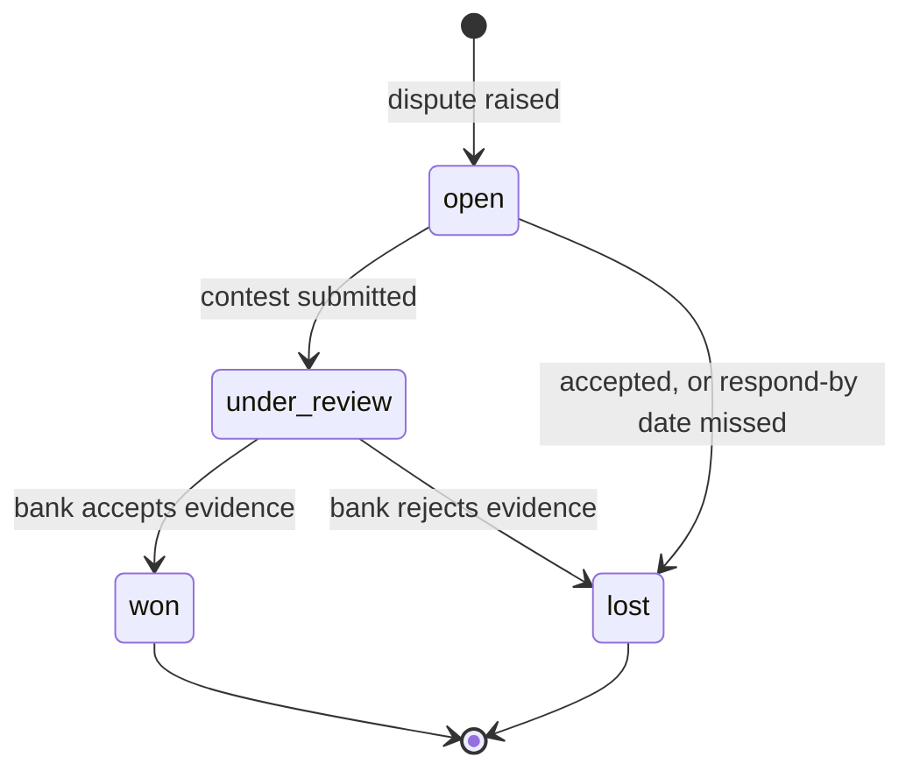
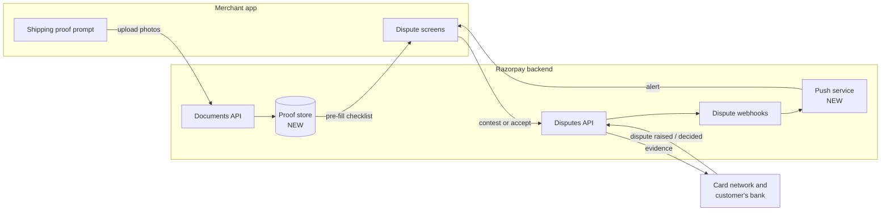

# Architecture notes

Technical notes only. For the product story, see [README.md](README.md).

## 1. How the prototype is built

**Stack:** one static file, `index.html`. HTML, CSS and plain JavaScript, no framework, no build step, no backend. Deployed as a static site on Vercel.

**Inside `index.html`:**

| Part | What it does |
| --- | --- |
| `PAYMENTS`, `OTHERS` | Synthetic data: 5 payments and 3 past disputes |
| `IMG` | Sample evidence (courier slip, parcel photos, chat, invoice) drawn as inline SVG, so there are no image files or external requests |
| `S` (state) | One object holding the screen stack, saved proof, dispute status, contest amount, explanation and timer |
| `SCREENS` | One render function per screen: Home, Payments, Payment details, Dispute, Contest, Review, Result |
| Click handler | A single listener that reads `data-` attributes on buttons (`data-go`, `data-action`, `data-disp` and so on) and updates state, then re-renders |
| Demo guide | The panel beside the phone: step tracker, alert-to-submit timer, and buttons that play the bank's decision |

**Dispute status in the prototype** follows the same transitions as Razorpay's dispute object:

The `closed` status (fraud disputes only) is left out on purpose.

**Real vs simulated:**

| Part | In the prototype |
| --- | --- |
| Screens, statuses, checklist logic, partial amount, photo selection, countdown, filters | Working |
| Camera and WhatsApp share | Simulated with sample images |
| Push notifications | Simulated inside the page |
| The bank's decision | Demo buttons |
| Other tabs (Products, Support, Account, Settlements) | Placeholders |
| Any connection to Razorpay or a bank | None |

## 2. How it would connect to Razorpay

Most of the plumbing already exists in Razorpay's public dispute APIs. In the real app these calls would go through Razorpay's own backend using the merchant's logged-in session. API keys never sit in the mobile app.

| App step | Uses | Exists today? |
| --- | --- | --- |
| Upload proof at shipping | `POST /v1/documents` with `purpose: dispute_evidence` (JPG, PNG, PDF) | Yes |
| Keep proof against a payment before any dispute | New proof store (below) | **New** |
| Alert when a dispute is raised | Webhook `payment.dispute.created` | Event yes, push to the seller's phone **new** |
| Dispute screen | Dispute object: `status`, `phase`, `amount`, `reason_code`, `respond_by`, `payment_id` | Yes |
| Contest, full or partial | `PATCH /v1/disputes/{id}/contest` with `amount`, `summary` (max 1000 characters), evidence lists, `action: submit` | Yes |
| Accept | `POST /v1/disputes/{id}/accept` | Yes |
| Final decision on Home and payment | Webhooks `payment.dispute.won`, `payment.dispute.lost` | Events yes, showing them on Home **new** |

## 3. New pieces Razorpay would need to build

**a. Proof store.** Saves evidence against a payment before any dispute exists.

| Field | Example |
| --- | --- |
| `payment_id` | `pay_OxT3mK7wPd1Zs9` |
| `document_id` | ID returned by the Documents API |
| `evidence_type` | `shipping_proof`, `billing_proof`, `customer_communication` |
| `label` | "Courier slip" |
| `source` | camera, gallery, share sheet |
| `saved_at` | timestamp |

When a dispute arrives, the app looks up proof by `payment_id` and drops each `document_id` into the matching evidence list in the contest call.

**b. Reason-to-proof map.** Turns a dispute's reason code into the checklist. Starting rules, taken from Razorpay's evidence guide:

| Reason | Checklist asks for |
| --- | --- |
| Goods not received (Visa 13.1, RuPay 1064, RZP01) | `shipping_proof`, `customer_communication`, `term_and_conditions` |
| Not as described (Visa 13.3, RuPay 1062) | Product photos (`others`), `customer_communication`, `refund_cancellation_policy` |
| Refund not processed (Visa 13.6, RuPay 1061, RZP04) | `refund_confirmation`, `customer_communication`, `refund_cancellation_policy` |
| Cancelled recurring payment (Visa 13.2) | `refund_cancellation_policy`, `access_activity_log`, `term_and_conditions` |

**c. Push alerts** to the seller's phone for the dispute webhooks above.

## 4. Security and data

- No API keys, secrets or personal data in this repo. All data is synthetic.
- In production, saved proof would be visible only to the account's owners and admins, and tied to a single payment.
- Customer chats can hold personal details, so proof should be deleted after a set period if no dispute arrives.

## 5. Open questions and gaps

- **When is the money taken?** Razorpay's fees page says the disputed amount is held when the dispute is raised and returned if you win. The dispute API page says `amount_deducted` stays 0 unless the dispute is lost. The prototype says "on hold", which fits both.
- **Evidence rejected:** webhook `payment.dispute.action_required` fires when evidence is insufficient or unreadable. The prototype does not handle it yet; the fix would reopen the checklist and point to the bad file.
- **Drafts:** the contest call supports `action: draft`. The prototype submits in one go; a real app should auto-save drafts.

## Sources

[Dispute object](https://razorpay.com/docs/api/disputes/entity/) · [Contest a dispute](https://razorpay.com/docs/api/disputes/contest/) · [Accept a dispute](https://razorpay.com/docs/api/disputes/accept/) · [Upload a document](https://razorpay.com/docs/api/documents/create/) · [Dispute webhooks](https://razorpay.com/docs/webhooks/disputes/) · [Evidence guide](https://razorpay.com/docs/payments/disputes/submit-evidence/) · [Chargeback fees](https://razorpay.com/docs/payments/disputes/chargeback-fees-and-penalties/) · [Payment states](https://razorpay.com/docs/payments/payments/)
